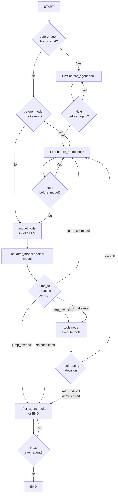

# Agent Execution: Agentic Loops and State Management

Agent execution in LangChain is built on a composable architecture where language models repeatedly plan, invoke tools, and interpret results in a structured loop. The [`create_agent`][langchain.agents.create_agent] factory function constructs this agentic loop by orchestrating:

1. **Model invocation** with bound tools and system prompt
2. **Middleware composition** (ordered request/response interception)
3. **Tool execution and routing** (looping, termination, or state jumps)
4. **Observability** (tracing, callbacks, state transitions)

This document explains the agent lifecycle, loop control, state management, middleware patterns, error handling, and real-world patterns for production agents.

## Agent Lifecycle: From Initialization to Termination

### Initialization Phase

When `create_agent()` is called, the factory:

1. **Resolves the model**: Converts string identifiers (e.g., `"openai:gpt-4o"`) to `BaseChatModel` instances via `init_chat_model()`.
2. **Normalizes tools**: Converts callables to `BaseTool` instances, preserves `BaseTool` and dict-based tools.
3. **Sets up structured output**: Creates pseudo-tools if `response_format` is provided (for `ToolStrategy`).
4. **Composes middleware**: Chains `wrap_model_call` and `wrap_tool_call` handlers, merges state schemas, registers node hooks.
5. **Constructs the graph**: Builds a LangGraph `StateGraph` with model, tools, and middleware nodes.
6. **Compiles**: Returns a `CompiledStateGraph` ready for execution.

### Agent State and State Schema

Every agent operates over an `AgentState` that persists across the execution loop:

```python
class AgentState(TypedDict, Generic[ResponseT]):
    """State schema for the agent."""
    messages: Required[Annotated[list[AnyMessage], add_messages]]
    jump_to: NotRequired[Annotated[JumpTo | None, EphemeralValue]]
    structured_response: NotRequired[Annotated[ResponseT, OmitFromOutput]]
```

**State fields:**
- **`messages`**: Conversation history, merged via `add_messages` reducer (new messages append, not replace).
- **`jump_to`**: Ephemeral routing hint set by middleware to override default flow ("tools", "model", or "end").
- **`structured_response`**: Parsed output when `response_format` is configured (omitted from input schema).

Middleware can extend `AgentState` via `state_schema` parameter. When multiple middleware extend state, schemas are merged in order with user-provided `state_schema` winning conflicts.

## The Agentic Loop

The core loop iterates through multiple phases until a stopping condition is met. The execution flows through middleware hooks (node-level) and wrapper handlers (operation-level).

### Phase 1: Model Invocation

The model node calls the language model with the current message history and bound tools. Returns an `AIMessage` with optional `tool_calls`.

**Detailed flow:**
1. Invalid tool calls from prior iterations are patched with error `ToolMessage` objects.
2. `before_model` middleware hooks execute in order, allowing state updates.
3. A `ModelRequest` is constructed with the current state, messages, model, tools, and system message.
4. Middleware `wrap_model_call` handlers execute (first = outermost), wrapping the core model invocation.
5. The wrapped handler calls the base `_execute_model_sync()` (or async variant), which:
   - Binds tools to the model via `model.bind_tools()`.
   - Invokes the model with `[system_message, *messages]`.
   - Handles structured output parsing if `response_format` is configured.
   - Returns `ModelResponse` with the result messages and optional structured response.
6. `after_model` middleware hooks execute in order, allowing logging, validation, or routing overrides via `state["jump_to"]`.

### Phase 2: Conditional Routing

After the model produces a response, the agent decides what to do next based on `state["jump_to"]` and the presence of tool calls:

- **If `state["jump_to"] == "end"`**: Jump to agent termination.
- **If `state["jump_to"] == "model"`**: Jump back to `before_model` (skip tools, retry model).
- **If `state["jump_to"] == "tools"`**: Force routing to tools node.
- **Else if `AIMessage.tool_calls` is non-empty**: Check for pending tool calls (not yet executed or in structured_output_tools). If pending calls exist, route to tools node.
- **Else if `state["structured_response"]` is not None**: A fresh structured output was produced this call—route to termination.
- **Else if tool calls exist but all are already executed or are structured tools**: Inject these tool messages and loop back to model.
- **Else** (no tool calls at all): Terminate.

### Phase 3: Tool Execution

If routed to tools, the agent executes each pending tool call:

1. For each tool call, the `ToolNode`:
   - Matches the tool call to a registered tool by name.
   - Creates a `ToolCallRequest` with the call, tool, state, and runtime.
   - Invokes middleware `wrap_tool_call` handlers (first = outermost), wrapping the tool execution.
   - The wrapped handler calls the base tool execution, which:
     - Executes the tool synchronously or asynchronously.
     - Catches exceptions and returns error `ToolMessage` objects.
   - Returns `ToolMessage` with the tool result or error.
2. `ToolMessage` objects are added to state.
3. Routing decision based on execution results:
   - If any executed tool has `return_direct=True`, route to termination.
   - If a structured output tool was executed (found in structured_output_tools), route to termination.
   - Otherwise, loop back to `before_model` for the model to process tool results.

### Loop Termination

The agent stops and runs termination hooks when:

- The model produces an `AIMessage` with no tool calls.
- A tool with `return_direct=True` completes execution.
- A structured output tool completes (automatic termination).
- `state["jump_to"] == "end"` is set by middleware.

**Termination phase:**
1. `after_agent` middleware hooks execute once (in reverse order if multiple) for cleanup, logging, or final state updates.
2. Graph returns final state (messages + optional structured response).

### State Graph Structure

The agent is internally represented as a `StateGraph` with the following nodes:

- **Middleware hooks** (if present): `{middleware}.before_agent`, `{middleware}.before_model`, `{middleware}.after_model`, `{middleware}.after_agent`
- **Core execution**: `model` (LLM invocation), `tools` (tool execution node)
- **Entry point**: First `before_agent` hook, else first `before_model` hook, else `model`.
- **Loop entry**: First `before_model` hook (or `model` if no before_model hooks).
- **Loop exit**: Last `after_model` hook (or `model` if no after_model hooks).
- **Exit point**: Last `after_agent` hook, else `END`.

Edges use conditional routing based on jump_to, tool calls, and structured output.

### Control Flow Diagram



This diagram shows the major execution paths and middleware hook insertion points.

## Creating an Agent with `create_agent()`

### Minimal Example

```python
from langchain.agents import create_agent
from langchain_openai import ChatOpenAI

@tool
def search(query: str) -> str:
    """Search for information."""
    return f"Results for {query}"

agent = create_agent(
    model="openai:gpt-4o",
    tools=[search],
    system_prompt="You are a helpful assistant"
)

result = agent.invoke({"messages": [{"role": "user", "content": "Search for AI news"}]})
print(result["messages"][-1].content)
```

### Factory Signature

```python
def create_agent(
    model: str | BaseChatModel,
    tools: Sequence[BaseTool | Callable[..., Any] | dict[str, Any]] | None = None,
    *,
    system_prompt: str | SystemMessage | None = None,
    middleware: Sequence[AgentMiddleware[StateT_co, ContextT]] = (),
    response_format: ResponseFormat[ResponseT] | type[ResponseT] | None = None,
    state_schema: type[AgentState[ResponseT]] | None = None,
    context_schema: type[ContextT] | None = None,
    checkpointer: Checkpointer | None = None,
    store: BaseStore | None = None,
    interrupt_before: list[str] | None = None,
    interrupt_after: list[str] | None = None,
    debug: bool = False,
    name: str | None = None,
    cache: BaseCache[Any] | None = None,
    transformers: Sequence[TransformerFactory] | None = None,
) -> CompiledStateGraph[AgentState[ResponseT], ContextT, InputAgentState, OutputAgentState[ResponseT]]
```

### Key Parameters

| Parameter | Purpose | Notes |
|-----------|---------|-------|
| `model` | Language model | String (e.g., `"openai:gpt-4o"`) or `BaseChatModel` instance |
| `tools` | Tool functions/schemas | `BaseTool`, callables, or dict schemas; can be empty |
| `system_prompt` | System instructions | String or `SystemMessage`; prefixed to every model call |
| `middleware` | Pre/post hooks and wrappers | Ordered list; first = outermost layer |
| `response_format` | Structured output schema | `ToolStrategy`, `ProviderStrategy`, or Pydantic class |
| `state_schema` | Custom state fields | Extends `AgentState` with application state |
| `checkpointer` | Conversation memory | Saves state per thread; enables resumption |
| `store` | Cross-thread persistence | Retrieve context across conversations |
| `interrupt_before/after` | Human-in-the-loop | Pause before/after named nodes |
| `debug` | Verbose logging | Prints execution trace |
| `name` | Graph name | Used for subagent identification in multi-agent systems |
| `cache` | Graph-level caching | Cache entire graph outputs |
| `transformers` | Stream output formatters | Custom `StreamTransformer` factories |

## Tool Binding and Execution

### Tool Types

Tools are bound to the model during agent creation. The factory accepts three formats:

1. **BaseTool instances** (preferred):
   ```python
   from langchain_core.tools import tool
   
   @tool
   def search(query: str) -> str:
       """Search for information."""
       return f"Results for {query}"
   
   agent = create_agent(model="openai:gpt-4o", tools=[search])
   ```

2. **Python callables** (auto-wrapped):
   ```python
   def search(query: str) -> str:
       """Search for information."""
       return f"Results for {query}"
   
   agent = create_agent(model="openai:gpt-4o", tools=[search])
   ```

3. **Dict schemas** (provider built-ins):
   ```python
   tools = [
       {
           "type": "builtin_text_search",  # Provider-specific
           "name": "search",
           "description": "Search for information"
       }
   ]
   agent = create_agent(model="anthropic:claude-opus", tools=tools)
   ```

### Tool Node and Execution Flow

When tools are provided, `create_agent` constructs a `ToolNode` that:

1. **Receives**: Model's `AIMessage` with `tool_calls`.
2. **Matches**: Each call to a registered tool by name.
3. **Executes**: Tool (sync or async, error handling included).
4. **Wraps**: Result in `ToolMessage` with tool call ID and name.
5. **Applies middleware**: `wrap_tool_call` handlers intercept execution.

The ToolNode validates that:
- All tool names referenced by the model are registered.
- Tools return proper result strings/structured data.
- Exceptions are caught and returned as error `ToolMessage` objects.

If a tool call fails during execution, the framework automatically generates an error `ToolMessage` and loops back to the model for recovery.

### Model Binding and Structured Output

Before calling the model, `create_agent` binds tools via `model.bind_tools()`:

```python
bound_model = model.bind_tools(
    final_tools,
    tool_choice=tool_choice,  # "any", "required", specific name, or None
    **model_settings
)
```

**Structured output** (when `response_format` is configured) adds special behavior:

- **ProviderStrategy**: Uses the model's native structured output API (e.g., OpenAI's response_format).
- **ToolStrategy**: Creates pseudo-tools for each schema; model calls the tool to return structured data.
- **AutoStrategy**: Auto-detects the best strategy based on model capabilities.

When ToolStrategy is used, the agent automatically:
1. Adds structured tools to the model's tool list.
2. Executes the tool call to parse the schema.
3. Stores the parsed result in `state["structured_response"]`.
4. Routes to termination (not looping back for more tools).

## Middleware: Hooks and Wrappers

Middleware instances allow customization at every stage of agent execution. They inherit from `AgentMiddleware` and implement any combination of hooks and wrappers. Middleware is composable: multiple middleware instances are applied in first-in-outermost order, where the first middleware in the list wraps all others.

### Hook-Based Middleware (Node Hooks)

Node hooks are called at specific points in the execution flow as separate graph nodes, returning state updates. Each hook can return a `dict[str, Any]` with state updates, which are merged using the state's reducers (e.g., `add_messages` for the `messages` field).

**Lifecycle hooks:**

- **`before_agent`** (runs once): Executes at the very start before any model call. Use for session initialization, validation, or injecting initial context.
  
- **`before_model`** (runs in loop): Executes before each model invocation. Use for message filtering, tool narrowing, system prompt modification, or state inspection.
  
- **`after_model`** (runs in loop): Executes after each model invocation. Use for response validation, logging, or routing overrides via `state["jump_to"]`.
  
- **`after_agent`** (runs once): Executes after agent termination. Use for cleanup, final logging, or persisting results.

**Example:**

```python
class MyMiddleware(AgentMiddleware):
    def before_agent(self, state: AgentState, runtime: Runtime) -> dict[str, Any] | None:
        """Called once before agent execution starts."""
        # Inject initial state, validate inputs, etc.
        return {"custom_field": "value"}
    
    def after_agent(self, state: AgentState, runtime: Runtime) -> dict[str, Any] | None:
        """Called once after agent execution completes."""
        # Log final state, cleanup, etc.
        return None
    
    def before_model(self, state: AgentState, runtime: Runtime) -> dict[str, Any] | None:
        """Called before each model invocation (runs in loop)."""
        # Modify messages, set tool constraints, etc.
        return None
    
    def after_model(self, state: AgentState, runtime: Runtime) -> dict[str, Any] | None:
        """Called after each model invocation (runs in loop)."""
        # Validate model output, log decisions, etc.
        return None
```

**Routing via `jump_to`:**

Node hooks can set `state["jump_to"]` to alter the execution flow:
- `"model"`: Jump back to `before_model` (skip tools, retry model).
- `"tools"`: Force routing to the tools node (execute tools).
- `"end"`: Skip to agent termination (after_agent hooks).

The hook must declare which destinations it can jump to by returning state updates with `jump_to` set; the graph's conditional edges will route accordingly.

### Wrapper-Based Middleware (Handler Wraps)

Wrappers intercept and control core operations by wrapping handler callbacks. Each wrapper receives a `handler` callable that executes the next layer.

#### `wrap_model_call` – Model Interception and Control

```python
from langchain.agents import ModelRequest, ModelResponse, ExtendedModelResponse, AgentMiddleware
from langgraph.types import Command

class RetryMiddleware(AgentMiddleware):
    def wrap_model_call(self, request: ModelRequest, handler):
        """Retry model call up to 3 times on error."""
        for attempt in range(3):
            try:
                response = handler(request)  # Call the inner handler (next layer or actual model)
                return response
            except Exception as e:
                if attempt == 2:
                    raise
                print(f"Attempt {attempt + 1} failed: {e}")
```

**How it works:**

The `wrap_model_call` handler receives a `ModelRequest` (containing model, messages, tools, system message, and state) and a `handler` callback. The handler executes the next layer (inner middleware or the actual model) and returns a `ModelResponse`. Middleware can call the handler multiple times, modify the request/response, or skip calling it entirely.

**Handler composition:**

Multiple `wrap_model_call` implementations compose via first-in-outermost order:
- Request flows: middleware[0].wrap_model_call → middleware[1].wrap_model_call → ... → actual model invocation.
- Response flows: actual model ← ... ← middleware[1] ← middleware[0].

Each middleware wraps the inner implementation, creating nested closures. Commands from inner layers are accumulated before being applied to state.

**Capabilities:**

- **Retry** on transient errors with exponential backoff.
- **Cache** responses by request hash; short-circuit by returning cached result without calling handler.
- **Fallback** to a different model if the primary one fails.
- **Modify request** via `request.override()`: change tools, system message, model settings, or even the model itself.
- **Rewrite response**: Transform the AI message content, modify tool calls, or parse structured output.
- **Inject state updates**: Return `ExtendedModelResponse` with a `Command` to update state.

**Return types:**

- `ModelResponse[ResponseT]`: Standard result with messages and optional structured output.
- `AIMessage`: Simplified return (auto-converted to `ModelResponse` internally).
- `ExtendedModelResponse[ResponseT]`: Response + optional `Command[Any]` for state updates.
  - The `Command` is applied through the state reducer, so messages in the command are **added** (not replaced) via `add_messages`.
  - For non-reducer fields, later commands overwrite earlier ones (outermost middleware wins).

#### `wrap_tool_call` – Tool Interception and Control

```python
from langchain.agents import AgentMiddleware
from langchain_core.messages import ToolMessage

class ToolRetryMiddleware(AgentMiddleware):
    def wrap_tool_call(self, request, handler):
        """Retry tool execution if result is invalid."""
        for attempt in range(2):
            result = handler(request)  # Execute the inner handler (next layer or actual tool)
            if self._is_valid(result):
                return result
        return result
    
    def _is_valid(self, result):
        # Custom validation logic
        if isinstance(result, ToolMessage):
            return result.status != "error"
        return True
```

**How it works:**

The `wrap_tool_call` handler receives a `ToolCallRequest` (containing the tool call dict, the matched `BaseTool`, state, and runtime) and a `handler` callback. The handler executes the next layer (inner middleware or the actual tool) and returns a `ToolMessage` or `Command`. Middleware can call the handler multiple times for retry logic, modify the request, or skip calling it.

**Handler composition:**

Multiple `wrap_tool_call` implementations compose via first-in-outermost order:
- Request flows: middleware[0].wrap_tool_call → middleware[1].wrap_tool_call → ... → actual tool invocation.
- Response flows: actual tool ← ... ← middleware[1] ← middleware[0].

Each handler call is independent and stateless; calling `handler(request)` multiple times produces fresh tool executions.

**Capabilities:**

- **Validate** tool arguments before execution via `request.override()`.
- **Retry** on errors or invalid outputs (call handler multiple times).
- **Monitor** tool usage, cost, or execution time.
- **Modify calls** by returning a new `ToolCallRequest` with transformed arguments via `request.override()`.
- **Mock** tools for testing by short-circuiting (not calling handler, returning a canned ToolMessage).
- **Error handling**: Catch exceptions and return error `ToolMessage` instead of propagating.

**Return types:**

- `ToolMessage`: Tool execution result with status, content, tool call ID, and name.
- `Command[Any]`: Route to a different node or update state (e.g., inject synthetic tool messages).

Exceptions propagate unless the handler or middleware catches them. If an exception escapes, it propagates to the agent (unless `handle_tool_errors=True` on `ToolNode`).

### Middleware Composition and Ordering

Middleware is applied in **first-in, outermost** order. The first middleware in the list wraps all others, creating a nesting structure where request flows go through the outermost middleware first.

```python
middleware = [CacheMiddleware(), RetryMiddleware(), LoggingMiddleware()]
agent = create_agent(model="openai:gpt-4o", tools=[...], middleware=middleware)
```

**Execution order for `wrap_model_call`:**
- Request flows outward-to-inward: `CacheMiddleware.wrap_model_call()` → `RetryMiddleware.wrap_model_call()` → `LoggingMiddleware.wrap_model_call()` → actual `_execute_model_sync()`.
- Response flows inward-to-outward: actual model result → `LoggingMiddleware` processes and returns → `RetryMiddleware` processes and returns → `CacheMiddleware` processes and returns.
- **Commands accumulation**: Commands from inner middleware are accumulated in list order (inner-first, then outer), and all are applied together to state after the model node completes.

**Execution order for node hooks (`before_model`, `after_model`, etc.):**
- Multiple middleware with `before_model` hooks are chained as separate graph nodes. The first middleware's `before_model` node executes first, then the second, etc.
- After the model node, `after_model` hooks execute in reverse order (last middleware first).
- This chaining is visible in the graph structure, e.g., `middleware_0.before_model` → `middleware_1.before_model` → `model`.

**State schema composition:**
Middleware state schemas are merged in order: `middleware[0].state_schema`, `middleware[1].state_schema`, ..., then `agent.state_schema` (if provided). Later schemas override earlier ones on field conflicts. The agent's explicit `state_schema` always wins, allowing users to override middleware state annotations.

## Middleware Hooks: State Transitions and Flow Control

The four lifecycle hooks (`before_agent`, `before_model`, `after_model`, `after_agent`) operate as separate nodes in the graph and can modify state or redirect execution via `state["jump_to"]`.

### Hook Execution Semantics

**`before_agent` hook:**
- Runs exactly once at the start, before the first model call.
- Used for session initialization, loading user context, or validating inputs.
- Can set `jump_to` to skip directly to tools or end (though typically just proceeds to `before_model` or `model`).

**`before_model` hook:**
- Runs before each model invocation (potentially multiple times in the loop).
- The first `before_model` hook (from first middleware that has one) serves as the loop entry point.
- Can modify messages, narrow tools, set system prompt hints, or skip the model via `jump_to="tools"` or `jump_to="end"`.

**`after_model` hook:**
- Runs after each model invocation (potentially multiple times in the loop).
- The last `after_model` hook (from last middleware that has one) serves as the loop exit point.
- Can validate model output, log decisions, or reroute via `jump_to` (including loop back to `before_model`).

**`after_agent` hook:**
- Runs exactly once at termination, after the last tool execution or after the model's final call without tools.
- Used for cleanup, final logging, or persisting results.
- Cannot use `jump_to` to restart the loop (termination is final); can only update state.

### State Updates via Hooks

When a hook returns a `dict[str, Any]`, the keys and values are merged into `state` using the state schema's reducers:

```python
def before_agent(self, state: AgentState, runtime: Runtime) -> dict[str, Any] | None:
    return {
        "messages": [HumanMessage(content="System: Starting agent")],  # Added via add_messages
        "custom_field": "value"  # Merged into state
    }
```

For the `messages` field (which uses `add_messages` reducer), returned messages are **appended**, not replaced. This allows hooks to inject synthetic messages without losing history.

### Flow Control via `jump_to`

Hooks can set `state["jump_to"]` to override the default routing:

```python
def after_model(self, state: AgentState, runtime: Runtime) -> dict[str, Any] | None:
    last_ai_message = next((m for m in reversed(state["messages"]) if isinstance(m, AIMessage)), None)
    if last_ai_message and "error" in last_ai_message.content:
        return {"jump_to": "model"}  # Retry the model instead of executing tools
    return None
```

The conditional edges in the graph check `state["jump_to"]` first before evaluating tool calls and routing logic. Valid destinations are `"model"`, `"tools"`, and `"end"`.

## Agent Execution Flow

### Synchronous vs. Asynchronous

`create_agent` returns a compiled graph that supports both sync and async execution:

```python
# Synchronous
result = agent.invoke({"messages": [...]})

# Asynchronous
result = await agent.ainvoke({"messages": [...]})

# Streaming (sync)
for chunk in agent.stream({"messages": [...]}, stream_mode="updates"):
    print(chunk)

# Streaming (async)
async for chunk in agent.astream({"messages": [...]}):
    print(chunk)
```

The graph automatically chooses sync or async based on the execution context. If a middleware implements only async (`awrap_model_call`) and is invoked synchronously, it raises `NotImplementedError`. Provide both implementations for maximum compatibility.

### Middleware Async/Sync Duality

Every middleware method has a sync and async variant:

- **Node hooks**: `before_agent` / `abefore_agent`, `before_model` / `abefore_model`, `after_model` / `aafter_model`, `after_agent` / `aafter_agent`.
- **Wrappers**: `wrap_model_call` / `awrap_model_call`, `wrap_tool_call` / `awrap_tool_call`.

When a middleware is instantiated, it can implement either or both variants:
- If only sync is implemented and the graph invokes async, `NotImplementedError` is raised.
- If only async is implemented and the graph invokes sync, `NotImplementedError` is raised.
- If both are implemented, the graph chooses the appropriate variant at execution time.

To maximize compatibility, implement both variants in your middleware, or use the helper decorators (if provided by the framework) to automatically bridge sync/async.

### Detailed Execution Steps

**Step 1: Graph Initialization**
- Graph entry point is determined: if `before_agent` hooks exist, entry is the first hook; else if `before_model` hooks exist, entry is the first hook; else entry is the `model` node.
- `START` edge leads to the entry point.

**Step 2: Agent Initialization** (if `before_agent` hooks exist)
- Middleware `before_agent` hooks run in order.
- Each hook receives the initial state and runtime context.
- State updates are merged using reducers.
- Control flows to the next hook, or to `before_model` (or `model` if no before_model).

**Step 3: Loop Iteration Starts** (before_model phase)
- If `before_model` hooks exist, they run in order.
- Each hook receives the current state and runtime.
- State updates are merged.
- Control flows to the `model` node.

**Step 4: Model Invocation**
- Invalid tool calls from prior iterations are automatically patched with error `ToolMessage` objects.
- A `ModelRequest` is constructed with current state, messages, model, tools, system message.
- Middleware `wrap_model_call` handlers execute (first = outermost):
  - Each handler wraps the next layer.
  - The innermost `wrap_model_call` wraps the core `_execute_model_sync()` or `_execute_model_async()` function.
  - The core function binds tools, invokes the model, handles structured output parsing.
- Response is returned as `ModelResponse` (with messages and optional structured_response).
- Control flows to `after_model` (if hooks exist) or to routing decision.

**Step 5: Post-Model Processing** (after_model phase, if hooks exist)
- Middleware `after_model` hooks run in order.
- Each hook receives the current state (with new model response messages) and runtime.
- Hooks can validate output, log, or set `state["jump_to"]` to override routing.
- Control flows to the routing decision logic.

**Step 6: Routing Decision**
- Priority: Check `state["jump_to"]` (set by a hook). If set to `"end"`, `"model"`, or `"tools"`, use that.
- Else, check the last `AIMessage` in state:
  - If no `AIMessage` exists, route to termination (unusual case).
  - If `AIMessage.tool_calls` is empty, route to termination (model didn't call tools).
  - Else, identify pending tool calls (not yet executed, and not in structured_output_tools).
    - If pending calls exist, route to `tools` node.
    - If no pending calls but AI message has calls, inject artificial tool messages (for middleware-synthesized results) and loop back to `before_model`.
  - Check for fresh structured response: if `state.get("structured_response")` is not None, route to termination.

**Step 7: Tool Execution** (if routed to tools)
- For each pending tool call:
  - Create a `ToolCallRequest` with tool call dict, matched tool, state, runtime.
  - Middleware `wrap_tool_call` handlers execute (first = outermost):
    - Each handler wraps the next layer.
    - The innermost handler wraps the core tool execution.
    - Core execution calls the tool synchronously/asynchronously, catches exceptions.
  - Result is a `ToolMessage` (with status, content, tool_call_id, name) or `Command`.
  - `ToolMessage` is added to state.
- After all tool calls are executed, routing decision:
  - If any executed tool has `return_direct=True`, route to termination.
  - If a tool in structured_output_tools was executed, route to termination.
  - Else, loop back to `before_model` for the model to process tool results.

**Step 8: Loop Continuation or Termination**
- If routing to `before_model`, go back to Step 3.
- Else, proceed to termination.

**Step 9: Agent Termination** (after_agent phase, if hooks exist)
- Middleware `after_agent` hooks run in reverse order (last middleware first).
- Each hook receives the final state and runtime.
- State updates are merged.
- Control flows to the next hook or to `END`.

**Step 10: Graph Exit**
- `END` is reached.
- Compiled graph returns the final state (messages + optional structured_response).

## Tool Execution Details

### Tool Node Structure and Execution

When tools are provided to `create_agent()`, a `ToolNode` is created that:

1. **Receives pending tool calls**: The graph routes `ToolCall` dictionaries to the `tools` node.
2. **Matches tools**: Looks up each tool call's `name` in the tool registry to find the corresponding `BaseTool`.
3. **Creates `ToolCallRequest`**: For each matched tool, constructs a request with the tool call dict, the `BaseTool`, current state, and runtime context.
4. **Invokes middleware `wrap_tool_call` handlers**: Composes all middleware wrappers and applies them around the core tool execution.
5. **Executes the tool**: Calls the tool's `invoke()` or `ainvoke()` method with the tool call arguments.
6. **Handles errors**: Catches exceptions during tool execution and returns error `ToolMessage` objects with `status="error"`.
7. **Returns `ToolMessage`**: Wraps the tool result (or error) in a `ToolMessage` with:
   - `content`: The tool result as a string or JSON.
   - `tool_call_id`: The ID from the original tool call.
   - `name`: The tool name.
   - `status`: `"success"` or `"error"`.

### Tool Message Patching

Before invoking the model, the agent automatically patches invalid tool calls:

- If a prior `AIMessage` has `invalid_tool_calls` (malformed arguments or parsing errors), the agent inserts error `ToolMessage` objects for those calls.
- Invalid calls are only patched once (tracked by tool call ID).
- This ensures the model sees errors for malformed calls and can recover or try a different tool.

### Tool Selection and Routing

After tool execution, routing is determined by:

1. **`return_direct` flag**: If any executed tool has `return_direct=True`, skip the loop and terminate immediately.
2. **Structured output completion**: If a tool in `structured_output_tools` was executed (and status is not "error"), exit the loop.
3. **Error status**: Tool execution errors (returned as `ToolMessage` with `status="error"`) do NOT cause termination—the agent loops back to the model to handle the error.
4. **Default**: Loop back to `before_model` so the model can process the tool results and decide the next action.

### Middleware Interception in Tool Execution

Middleware `wrap_tool_call` handlers can:

- **Validate arguments** before execution by inspecting or modifying `request.tool_call["args"]`.
- **Retry on failure** by calling `handler(request)` multiple times.
- **Monitor usage** by tracking tool calls and results.
- **Mock tools** for testing by returning a synthetic `ToolMessage` without calling the handler.
- **Modify tool calls** by using `request.override(tool_call={...})` to transform arguments.

Each call to `handler(request)` is independent; multiple calls execute the tool fresh each time.

## Loop Control: Max Iterations and Stopping Criteria

### Max Iterations

The agent loop has a default recursion limit of 9,999 iterations to prevent infinite loops. You can configure this per invocation:

```python
result = agent.invoke(
    {"messages": [...]},
    config={"recursion_limit": 100}  # Custom limit
)
```

### Stopping Criteria

The agent stops under these conditions:

1. **No tool calls**: Model returns `AIMessage` with empty `tool_calls` list.
2. **Structured output complete**: A `ToolStrategy` structured tool was executed.
3. **return_direct flag**: A tool with `return_direct=True` completes.
4. **jump_to == "end"**: Middleware explicitly routes to termination.
5. **Recursion limit exceeded**: Graph hits configured recursion limit.

## Observability: Tracing and Callbacks

### LangSmith Integration

All agent execution is automatically traced to LangSmith (if configured). Traces capture:

- **Model node invocations** (with tool bindings and system prompt).
- **Middleware hooks** (before/after execution points).
- **wrap_model_call and wrap_tool_call** interceptions (request/response details).
- **Tool executions** (with arguments, results, and errors).
- **State transitions** (messages, structured response, routing decisions).

Traces are scoped hierarchically: outer middleware wraps inner, showing composition visually.

### Trace Policy and Privacy

Middleware can configure trace privacy via `trace_policy`:

```python
from langgraph.types import TracePolicy, omit_payload

class MyMiddleware(AgentMiddleware):
    trace_policy = TracePolicy(process_inputs=omit_payload)  # Hide sensitive inputs
```

This allows middleware to drop message payloads while keeping timing and span structure.

### Debug Mode

Enable verbose logging to stdout:

```python
agent = create_agent(
    model="openai:gpt-4o",
    tools=[...],
    debug=True
)

result = agent.invoke({"messages": [...]})
# Prints: node transitions, state updates, execution trace
```

Debug output shows:
- Each node invocation.
- State updates at each step.
- Tool calls and results.
- Routing decisions.

### State Inspection

Access the runtime context in middleware hooks:

```python
class ObservableMiddleware(AgentMiddleware):
    def before_model(self, state: AgentState, runtime: Runtime) -> dict[str, Any] | None:
        # runtime.config contains execution configuration
        # runtime.step_number shows iteration count
        print(f"Step {runtime.step_number}: {len(state['messages'])} messages")
        return None
```

## Common Middleware Patterns

### Pattern 1: Tool Selection and Routing

Narrow the tools available to the model based on context:

```python
from langchain.agents import AgentMiddleware, ModelRequest

class ContextualToolSelector(AgentMiddleware):
    def before_model(self, state, runtime):
        # Narrow tools based on conversation context
        user_level = state.get("user_level", "basic")
        if user_level == "admin":
            # Admin has access to all tools
            pass
        else:
            # Regular users see subset
            pass
        return None
    
    def wrap_model_call(self, request: ModelRequest, handler):
        # Filter tools dynamically
        advanced_tools = [t for t in request.tools if "admin" not in t.name]
        request = request.override(tools=advanced_tools)
        return handler(request)
```

### Pattern 2: Retry and Error Recovery

Implement exponential backoff or fallback strategies:

```python
import asyncio
from langchain.agents import AgentMiddleware, ModelRequest, ModelResponse
from langchain_core.messages import AIMessage

class SmartRetryMiddleware(AgentMiddleware):
    async def awrap_model_call(self, request: ModelRequest, handler):
        backoff = 1
        for attempt in range(3):
            try:
                return await handler(request)
            except Exception as e:
                if attempt < 2:
                    await asyncio.sleep(backoff)
                    backoff *= 2
                else:
                    # Fallback: return safe response
                    return ModelResponse(
                        result=[AIMessage(content="I encountered an error. Please try again.")]
                    )
```

### Pattern 3: Output Formatting and Validation

Post-process model responses to ensure compliance:

```python
from langchain.agents import AgentMiddleware, ModelResponse
from langchain_core.messages import AIMessage

class OutputFormatterMiddleware(AgentMiddleware):
    def wrap_model_call(self, request, handler):
        response = handler(request)
        # Ensure response is ModelResponse
        if isinstance(response, AIMessage):
            response = ModelResponse(result=[response])
        
        # Post-process AI message
        ai_msg = response.result[0]
        formatted_content = f"Response: {ai_msg.content}"
        return ModelResponse(
            result=[AIMessage(content=formatted_content, tool_calls=ai_msg.tool_calls)],
            structured_response=response.structured_response
        )
```

### Pattern 4: Tool Error Handling and Fallback

Handle tool execution failures gracefully:

```python
from langchain.agents import AgentMiddleware
from langchain_core.messages import ToolMessage

class ToolErrorHandlerMiddleware(AgentMiddleware):
    def wrap_tool_call(self, request, handler):
        try:
            return handler(request)
        except Exception as e:
            # Return error message instead of crashing
            return ToolMessage(
                content=f"Tool error: {str(e)}. Please retry or use a different tool.",
                tool_call_id=request.tool_call["id"],
                name=request.tool_call["name"],
                status="error"
            )
```

### Pattern 5: Dynamic Tool Registration

Register tools at runtime based on context:

```python
from langchain.agents import AgentMiddleware, ModelRequest

class DynamicToolMiddleware(AgentMiddleware):
    tools = []  # Will be populated at runtime
    
    def before_model(self, state, runtime):
        # Update available tools based on user context
        user_id = state.get("user_id")
        if user_id:
            self.tools = self._load_user_tools(user_id)
        return None
    
    def wrap_model_call(self, request: ModelRequest, handler):
        # Add dynamic tools to request
        all_tools = list(request.tools) + self.tools
        request = request.override(tools=all_tools)
        return handler(request)
```

### Pattern 6: Structured Output with Fallback

Handle both provider-native and tool-based structured output:

```python
from langchain.agents import AgentMiddleware, ModelRequest
from langchain.agents.structured_output import ProviderStrategy, ToolStrategy

class StructuredOutputMiddleware(AgentMiddleware):
    def wrap_model_call(self, request: ModelRequest, handler):
        # Try provider strategy first
        if request.response_format:
            try:
                return handler(request)
            except Exception:
                # Fall back to tool strategy
                request = request.override(
                    response_format=ToolStrategy(schema=request.response_format.schema)
                )
                return handler(request)
        return handler(request)
```

## Error Handling and Resilience

### Invalid Tool Calls

When a model generates a tool call with:
- **Malformed arguments** (JSON parse error, missing required fields)
- **Unknown tool name**

The agent automatically patches these by inserting error `ToolMessage` objects before retrying the model. Middleware can intercept these via `wrap_model_call` or `after_model` hooks.

### Middleware-Induced Tool Mismatches

If middleware adds tools via `wrap_model_call` but doesn't handle their execution:

```
ValueError: DYNAMIC_TOOL_ERROR_TEMPLATE
Unknown tools: [dynamic_tool]
```

**Solutions:**
1. Register tools upfront via `create_agent(tools=[...])`.
2. Implement `wrap_tool_call` in the middleware to handle dynamic tools.
3. Use dict-based tools if the provider natively supports them.

### Async-Sync Context Mismatch

If middleware implements only async (`awrap_model_call`) but the agent is invoked synchronously:

```
NotImplementedError: Asynchronous implementation of awrap_model_call is not available.
```

**Solutions:**
1. Implement both `wrap_model_call` and `awrap_model_call`.
2. Use decorators: `@wrap_model_call` for sync, then adapt for async.
3. Invoke the agent asynchronously: `agent.ainvoke()` or `agent.astream()`.

### Tool Execution Errors

Tool execution errors are caught and returned as `ToolMessage` with `status="error"`. The agent loops back to the model with the error message, allowing it to recover or try a different tool.

## Practical Example: Multi-Tool Planner Agent

```python
from langchain.agents import create_agent, AgentMiddleware, ModelRequest, ModelResponse
from langchain_core.tools import tool
from langchain_core.messages import AIMessage, HumanMessage
from langchain_openai import ChatOpenAI

# Define tools
@tool
def search(query: str) -> str:
    """Search the web."""
    return f"Results for: {query}"

@tool
def calculate(expr: str) -> str:
    """Evaluate a math expression."""
    return str(eval(expr))

# Middleware for planning
class PlannerMiddleware(AgentMiddleware):
    def before_agent(self, state, runtime):
        # Inject a planning step at the start
        plan_request = HumanMessage(
            content="First, make a plan for how to solve this problem. Then execute it."
        )
        return {"messages": [plan_request]}

# Create agent
agent = create_agent(
    model=ChatOpenAI(model="gpt-4o"),
    tools=[search, calculate],
    system_prompt="You are a helpful assistant with access to search and math tools.",
    middleware=[PlannerMiddleware()],
    debug=True
)

# Run
result = agent.invoke({
    "messages": [{"role": "user", "content": "What is the population of France times 2?"}]
})

print(result["messages"][-1].content)
```

## Performance and Scaling

### Checkpointing for Resumption

Store agent state per conversation thread to enable pausing and resuming:

```python
from langgraph.checkpoint.memory import MemorySaver

agent = create_agent(
    model="openai:gpt-4o",
    tools=[...],
    checkpointer=MemorySaver()
)

# First invocation
thread = {"configurable": {"thread_id": "user_123"}}
result = agent.invoke({"messages": [...]}, thread)

# Resume later
result2 = agent.invoke({"messages": [...]}, thread)  # Resumes from saved state
```

### Cross-Thread Persistence

Store data accessible across multiple conversations:

```python
from langgraph.store.memory import InMemoryStore

agent = create_agent(
    model="openai:gpt-4o",
    tools=[...],
    store=InMemoryStore()
)

# Middleware can query the store
class ContextMiddleware(AgentMiddleware):
    def before_model(self, state, runtime):
        # Load user context from store
        user_id = state.get("user_id")
        if user_id and runtime.store:
            context = runtime.store.get("user_context", user_id)
            # Use context to shape model behavior
        return None
```

### Caching and Streaming

Enable graph-level caching and configure stream transformers:

```python
from langgraph.cache.base import BaseCache

agent = create_agent(
    model="openai:gpt-4o",
    tools=[...],
    cache=my_cache,  # Cache entire graph outputs
    transformers=[my_transformer]  # Custom stream formatters
)

# Stream with updates
for chunk in agent.stream(
    {"messages": [...]},
    stream_mode="updates",
    config={"recursion_limit": 100}
):
    print(chunk)
```

## Testing and Debugging

### Debug Mode

Enable verbose logging:

```python
agent = create_agent(
    model="openai:gpt-4o",
    tools=[...],
    debug=True
)

result = agent.invoke({"messages": [...]}, debug=True)
# Prints node transitions, state updates, and execution trace
```

### Mocking Tools for Unit Tests

```python
from langchain_core.tools import tool

@tool
def mock_search(query: str) -> str:
    """Mock search tool."""
    if "AI" in query:
        return "Artificial Intelligence is..."
    return "No results"

agent = create_agent(
    model="openai:gpt-4o",
    tools=[mock_search]
)

# Test agent
result = agent.invoke({"messages": [{"role": "user", "content": "Tell me about AI"}]})
assert "Artificial Intelligence" in result["messages"][-1].content
```

### Testing Middleware

```python
from langchain.agents import ModelRequest, ModelResponse
from langchain_core.messages import AIMessage

def test_retry_middleware():
    middleware = SmartRetryMiddleware()
    request = ModelRequest(model=model, messages=[], tools=[])
    
    call_count = 0
    def failing_handler(req):
        nonlocal call_count
        call_count += 1
        if call_count < 2:
            raise ValueError("Transient error")
        return ModelResponse(result=[AIMessage(content="Success")])
    
    result = middleware.wrap_model_call(request, failing_handler)
    assert call_count == 2  # Retried once
    assert "Success" in result.result[0].content
```

## Integration with LangGraph

Agents created by `create_agent()` are LangGraph `StateGraph` instances that can:

1. **Be subgraphs**: Added to larger agent networks for multi-agent systems.
2. **Use interrupts**: Pause execution for human review or intervention.
3. **Stream outputs**: Real-time token-by-token responses.
4. **Support nested graphs**: Hierarchical agentic structures.

The `name` parameter helps identify subagents in trace logs and error messages.

## Related Concepts

- **Chat Models**: Language models that accept messages and return responses (see `/openwiki/concepts/chat-models.md`)
- **Tools**: Schema-driven functions that agents can invoke (see `/openwiki/concepts/tools.md`)
- **Middleware Framework**: Base classes and decorators for custom extensions (see `/openwiki/workflows/middleware.md`)
- **Streaming**: Real-time output via `stream()` and `astream()`
- **Structured Output**: Type-safe results from language models
- **Composability**: Building complex workflows from agents and tools (see `/openwiki/workflows/composability.md`)
